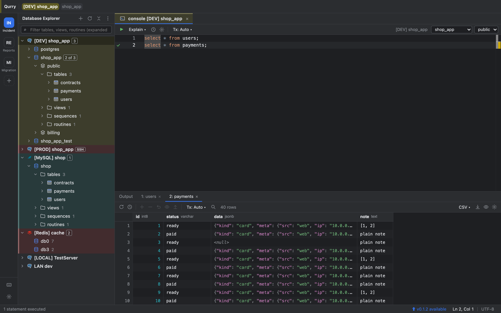
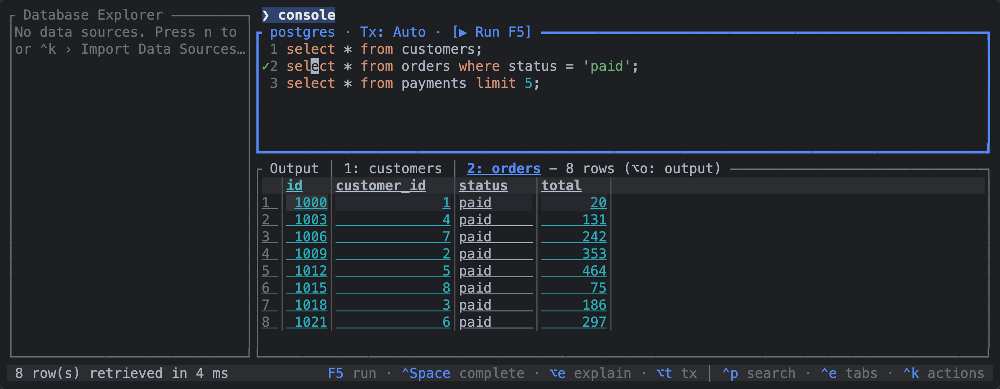

# Qurry

One Rust engine behind a desktop app, a terminal UI and an MCP server for AI tools: all three share your data sources and passwords, and the engine itself enforces read-only access for AI tools (on PostgreSQL and MySQL, one reading statement in a READ ONLY transaction that is rolled back). On top of it sit a DataGrip-style desktop app and a terminal UI that works over SSH. Free and open source. query + ferry. Formerly **dbtool**.





## Use with Claude Code

1. Install the TUI and the MCP server: `brew install hkhyyy/qurry/qurry` (macOS, Linux).
2. Add the MCP server: `claude mcp add qurry -- qurry-mcp` (read-only, the default). To let it change data too: `claude mcp add qurry-rw -- qurry-mcp --allow-write` (only on data sources set to Read & write).
3. Share a data source: in Qurry, **Data Source Properties › Options › MCP (AI tools)** › **Read** (TUI: the `MCP` field in the data source form). New data sources start Off, so the AI tool doesn't see them.

More in [MCP server](docs/mcp.md) and its [threat model](docs/mcp-security.md).

## Databases

PostgreSQL, MySQL / MariaDB and Redis (Standalone, Sentinel, Cluster) are built in. SQL Server, Oracle, SQLite, DuckDB, ClickHouse, MongoDB and the vector databases Qdrant, Chroma and Milvus work through drivers added when you need them; pgvector works in PostgreSQL itself ([Data sources](docs/data-sources.md), [Vector databases](docs/vector-and-rag.md)).

## Features

- **Free and open source**, a free DataGrip alternative: explorer, query console, data editor, explain plan, DDL, full-text search, data export (CSV, TSV, JSON, SQL INSERT, Markdown) and import (CSV, TSV, JSON, Excel), with DataGrip-style shortcuts.
- **Workspaces.** Separate sets of tabs and data sources per task (an incident, a report), switched with `⌘1`…`⌘9` (TUI: `⌥1`…`⌥9`). Consoles keep their session, open transactions and results while you are elsewhere, and the GUI and the TUI share the list ([Workspaces](docs/workspaces.md)).
- **Safe for AI.** Each data source is Off, Read or Read & write for MCP, and the MCP server is read-only by default. The engine checks and enforces it, so it doesn't depend on what the AI tool does.
- **Small and fast.** Rust + Tauri, no JVM. SSH and AWS SSM tunnels, SSL/TLS, Redis Sentinel and Cluster built in.

| Binary | What it is |
|---|---|
| **Qurry** (GUI, Tauri) | Desktop app modeled on DataGrip |
| **qurry-tui** | Terminal UI — works on its own, no GUI needed |
| **qurry-mcp** | MCP server so AI tools such as Claude Code can explore and query your databases |

All three share the same data sources and passwords, so a connection created in one shows up in the others.

## Trust

- **Passwords** are kept in `secrets.json` in the config folder, encrypted with AES-256-GCM. The key is in `secret.key` in the same folder, or in the OS keychain if you move it there in **Settings › Passwords** (TUI: `⌃k` › Password Key…).
- **Nothing about you goes over the network**: no usage data, no crash reports. Besides your databases, the apps ask GitHub for updates: one request to the GitHub API when the app starts and at most once an hour (what else may go out, such as a driver download you start, is listed in [Safety › Trust](docs/safety.md#trust)). Turn the check off with **Check for updates automatically** in Settings › Updates, `qurry-tui --no-update-check` or `QURRY_NO_UPDATE_CHECK=1`.
- **Releases** are built by GitHub Actions pinned to commit SHAs, with `SHA256SUMS`, a minisign signature and build provenance attestations, and the apps check the signature before installing an update.

All of it in full: [Safety › Trust](docs/safety.md#trust). The MCP server's [threat model](docs/mcp-security.md), and how to report a vulnerability: [SECURITY.md](SECURITY.md).

## Install

```bash
brew install hkhyyy/qurry/qurry      # TUI + MCP (macOS, Linux)
```

The desktop app (macOS 13+ `.dmg`, Linux `.AppImage` / `.deb`) and the TUI archives are on the [Releases](https://github.com/Hkhyyy/qurry/releases) page. Both apps tell you when a new version is out and update themselves. Details: [Getting started](docs/getting-started.md).

**macOS first launch:** the app isn't code-signed or notarized yet ([#57](https://github.com/Hkhyyy/qurry/issues/57), waiting for demand), so macOS warns the first time. Right-click the app › Open, or run `xattr -dr com.apple.quarantine /Applications/Qurry.app`.

## User guide

Also in Korean: [한국어 사용설명서](docs/ko/README.md)

- [Getting started](docs/getting-started.md) — install, first data source, first query
- [Data sources](docs/data-sources.md) — supported databases, SSH / SSL, Production mode, drivers
- [Workspaces](docs/workspaces.md)
- [Database tools](docs/database-tools.md) — admin reports, diagrams, compare & migrate, backup, history, explain
- [Vector databases and AI search (RAG)](docs/vector-and-rag.md)
- [MCP server](docs/mcp.md) — for Claude Code and other AI tools ([threat model](docs/mcp-security.md))
- [Safety](docs/safety.md)
- Keyboard shortcuts: [GUI](docs/shortcuts-gui.md) · [TUI](docs/shortcuts-tui.md)
- [Development](docs/development.md) — build from source, tests

## Contributing and security

See [CONTRIBUTING.md](CONTRIBUTING.md). Report vulnerabilities privately as described in [SECURITY.md](SECURITY.md).

## License

[MIT](LICENSE)
